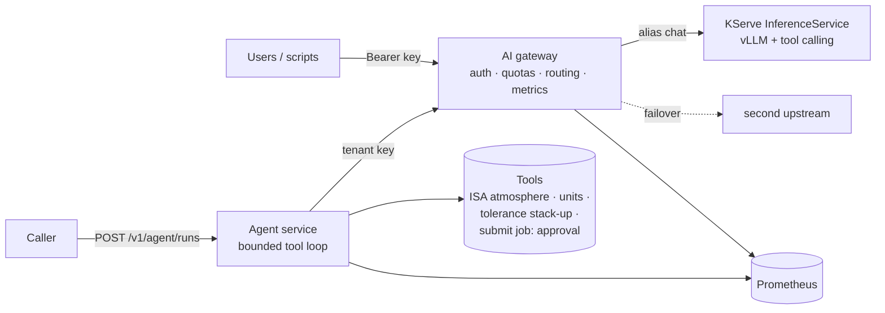

# AI Gateway & Tool-Calling Agent
### Shared LLM plumbing: auth, quotas, failover — plus a bounded agent that other services can call

An OpenAI-compatible **gateway** and a **tool-calling agent** microservice, with
Kubernetes / OpenShift AI manifests for vLLM behind KServe.


| | |
|:--|:--|
| **Problem** | Every client re-implements keys, quotas, routing and logging; agents add opaque tool loops on top. |
| **Verify** | `pip install -e '.[dev]' && pytest` (46 tests) · `docker compose up --build` · `make validate` |
| **Status & limits** | Laptop + mock model measured (~1.5 ms gateway overhead). OpenShift AI / KServe manifests prepared and schema-validated; **not applied to a live cluster**. CI written, not enabled. |
| **Next** | Deploy on OpenShift AI; shared multi-replica quotas; tool-calling accuracy with a real model. |

## Abstract

Teams that self-host language models end up writing the same plumbing in every
client: API keys, per-team limits, choosing a backend, retrying when one is down,
and deciding what may be logged. Agents make it worse, because each one adds a
loop of model calls and tool executions that nobody can see. This repository
puts that plumbing in two services. An **OpenAI-compatible gateway** owns
authentication, per-tenant request and token quotas, model aliases with
failover, streaming pass-through, metrics, and a logging policy that never
records prompt text. An **agent microservice** reaches models only through the
gateway and runs a bounded tool-calling loop in which the model proposes and
code decides: every tool call is looked up, parsed, validated against a typed
schema, run with a timeout, and recorded; tools with side effects stop the run
for human approval. The stack runs on a laptop against a deterministic mock
model; OpenShift AI / KServe manifests target a vLLM InferenceService with tool
calling. Measured gateway overhead is about 1.5–1.7 ms per request at low
concurrency (laptop, mock upstream).

**Keywords:** AI gateway · agentic microservices · tool calling · vLLM · KServe ·
OpenShift AI · rate limiting · observability · human oversight

## 1. Architecture



*Figure 1. Request path. Only the gateway is exposed (OpenShift Route); the agent
and the predictor accept traffic only from where they should (NetworkPolicies).*

| Component | Responsibility | Code |
|---|---|---|
| Gateway | auth by key hash, model allow-lists, `max_tokens` cap, request + token quotas, ordered failover, SSE pass-through, usage accounting | [`gateway/`](src/agent_stack/gateway) |
| Agent | tool registry, JSON + pydantic validation, timeouts, step limit, approval stop, run record | [`agent/`](src/agent_stack/agent) |
| Mock model | OpenAI-compatible test double with keyword tool selection and configurable TTFT / per-token delay | [`mockllm/`](src/agent_stack/mockllm) |

Design decisions and their limits: [`docs/design.md`](docs/design.md).
Agent loop, tools and records: [`docs/agent.md`](docs/agent.md).

## 2. Gateway

| Concern | Behaviour |
|---|---|
| Identity | tenants are identified by `sha256(api_key)`; configs never contain keys |
| Access | each tenant lists the aliases it may call; unknown → 404, forbidden → 403 |
| Cost bound | `max_tokens` capped per tenant before the request reaches a GPU |
| Quotas | token buckets per tenant for requests/min and tokens/min, charged from upstream `usage`; `429` with `Retry-After` |
| Routing | alias → ordered upstreams; connection errors and 5xx fail over, 4xx returned as-is |
| Streaming | bytes forwarded unchanged; `include_usage` forced so streamed requests are still accounted |
| Traceability | `x-request-id` (validated), `x-gateway-model`, `x-gateway-upstream` on every response |
| Logs | one JSON line per request with tenant, model, upstream, status, latency, TTFT, token counts; no content (tested) |
| Metrics | requests, latency, TTFT, tokens, upstream failures, quota rejections |

## 3. Agent

The agent exposes `POST /v1/agent/runs`. Each run returns its status
(`completed`, `awaiting_approval`, `max_steps`), the answer, every step and a
record with code version, prompt hash, model alias and tool versions.

| Tool | Purpose | Verified against |
|---|---|---|
| `isa_atmosphere` | T, p, ρ, a at 0–20 km | ICAO standard atmosphere tables |
| `convert_units` | length, pressure, force, mass, temperature | exact unit definitions |
| `tolerance_stackup` | worst-case and RSS 1-D stack | hand calculation |
| `submit_simulation_job` | queue a CFD/FEA job | not executed: returns the proposed call for approval |

Failure handling is tested case by case: unknown tool, malformed JSON, arguments
out of range, tool raising, loop not converging, gateway quota exceeded, wrong
API key. None of them crash a run; each becomes either a message the model can
correct or a clear HTTP error for the caller.

## 4. Measurements

Gateway overhead against an instant mock model, one machine (Apple M1 Pro), one
uvicorn worker per service, median of 3 interleaved repeats of 1 500 requests
([method and full table](docs/benchmark.md)):

| Mode | Concurrency | Direct p50 | Through gateway p50 | Added |
|---|---:|---:|---:|---:|
| non-stream | 1 | 1.03 ms | 2.67 ms | +1.65 ms |
| stream | 1 | 1.55 ms | 3.09 ms | +1.54 ms |
| stream | 8 | 7.50 ms | 15.28 ms | +7.78 ms |

Profiling the first version showed the streaming relay re-serialising every
event; forwarding bytes unchanged halved the added latency at 8 concurrent
streams (+16.1 → +7.8 ms) and doubled throughput (206 → 401 req/s). At 32
concurrent requests a single worker saturates with either version; that is a
replica count problem.

## 5. Deployment

```
deploy/
├── base/                    gateway (2 replicas, PDB, HPA), agent, ServiceAccounts, NetworkPolicies
├── components/kserve-vllm/  ServingRuntime (vLLM, --enable-auto-tool-choice) + InferenceService + predictor policy
└── overlays/
    ├── kind/                mock model, dev Secret, kube-dns egress
    └── openshift-ai/        Route (edge TLS), router/monitoring policy groups, openshift-dns egress, KServe component
```

- Containers run as non-root with a read-only root filesystem, no capabilities and
  `RuntimeDefault` seccomp. No fixed UID in the manifests, so the same pods are
  admitted by OpenShift's `restricted-v2` SCC and by Pod Security `restricted`.
- The image is built for OpenShift's arbitrary UIDs (group 0) and accepts a
  `PIP_INDEX_URL` build argument for builds behind a package mirror.
- The gateway scales on CPU; the model should scale on queue depth
  (`vllm:num_requests_waiting`) instead, which is why the InferenceService is pinned
  to one replica rather than given a CPU autoscaler.

```bash
# laptop
docker compose up --build
curl -s localhost:8000/v1/agent/runs -H 'content-type: application/json' \
  -d '{"task": "Air density at 11000 m in the ISA model?"}'

# OpenShift AI (see the header of deploy/overlays/openshift-ai/kustomization.yaml)
kustomize build deploy/overlays/openshift-ai | oc apply -f -
```

## 6. Verification

| Check | How | Status |
|---|---|---|
| Unit + integration tests | `pytest`: gateway, config, tools, agent loop, agent → gateway → model in-process | 46 passing |
| Lint | `ruff check`, `ruff format --check` | clean |
| Core manifests | rendered overlays against Kubernetes 1.30 strict JSON schemas | all objects valid (kind: 19, OpenShift AI: 17 core) |
| Custom resources | [`scripts/validate_crds.py`](scripts/validate_crds.py) against KServe v0.21.0 and OpenShift Route CRDs, unknown fields rejected | Route, ServingRuntime, InferenceService valid; a typo control is rejected |
| CI | [`ci/github-actions-ci.yml`](ci/github-actions-ci.yml): tests, `make validate`, image build, compose end-to-end | written, not enabled yet (needs a token with `workflow` scope) |

## 7. Not done

- Not yet applied to a live OpenShift cluster; the image is not yet published to a registry.
- Quotas are per replica (see design notes); a shared limiter (Limitador/Redis) is the next step.
- No tool-calling accuracy evaluation with a real model. The mock proves the
  plumbing, not the model's judgement.
- Paused runs are not resumable: after approval the caller re-submits.

## References

1. vLLM, *OpenAI-compatible server* and *tool calling* documentation.
2. KServe, *ServingRuntime* and *InferenceService* (v1beta1) APIs, RawDeployment mode.
3. Red Hat OpenShift, *Routes* and *NetworkPolicy* with policy groups.
4. ICAO Doc 7488, *Manual of the ICAO Standard Atmosphere*.
5. Regulation (EU) 2024/1689 (AI Act), Articles 12 and 14.

MIT License.

## Physics tools

ISA helpers ship with an analytical-baseline validation note: [`docs/physics-validation.md`](docs/physics-validation.md). Domain gates and CI point tests belong with the tools, not in the LLM.

## Security & physics proofs

- Agent / gateway boundary map: [`docs/security-tests.md`](docs/security-tests.md)
- ISA analytical baselines (pytest): [`docs/physics-validation.md`](docs/physics-validation.md)
