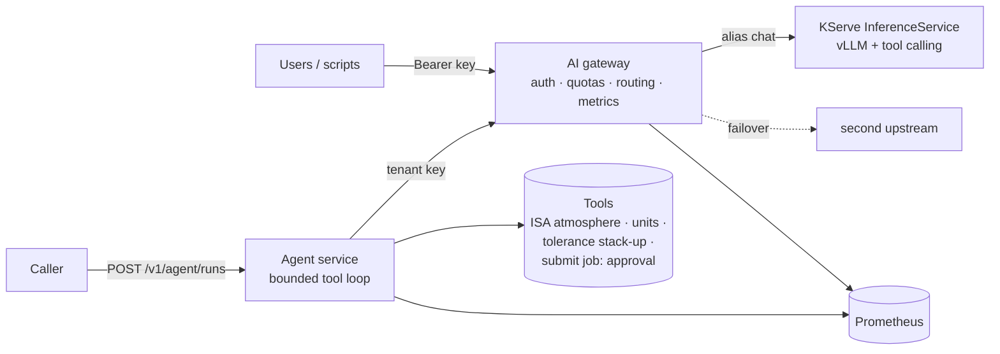

# AI gateway & tool-calling agent


Every client that talks to a self-hosted LLM tends to reinvent keys, quotas, and routing. Agents make it worse: opaque tool loops nobody can audit. This repo puts that plumbing in two services.

1. **Gateway** — OpenAI-compatible. Auth by key hash, per-tenant request and token quotas, model aliases with failover, streaming pass-through, metrics, logs without prompt text.
2. **Agent** — reaches models only through the gateway. Allowlisted tools, typed schemas, timeouts; side-effect tools stop for **approve-once** human approval.

**Start here:** [`docs/DEMO.md`](docs/DEMO.md) and the Kind Ready + agent-run transcripts under [`docs/evidence/kind-apply/`](docs/evidence/kind-apply/).

FastAPI services, Docker, Kubernetes / OpenShift overlays, KServe vLLM manifests, Prometheus. Tests cover allowlist, approve-once, ISA, and injection. Kind runs against **mock-llm**; gateway overhead is about **1.5 ms** p50 at concurrency 1 on a laptop mock. GHCR digest is recorded in the repo. Not claimed: live GPU OpenShift, or tool-calling accuracy with a real model.

Measured serving levers live in [vllm-serving-benchmark-t4](https://github.com/lyftium/vllm-serving-benchmark-t4). KServe packaging also in [drawing-review-service](https://github.com/lyftium/drawing-review-service) `deploy/kserve/`.

[Trust](#trust-boundary) · [Architecture](#architecture) · [Gateway](#gateway) · [Agent](#agent) · [Measurements](#measurements) · [Deploy](#deploy) · [Status](#status)

## Trust boundary

The model may **propose** a tool call; the service **decides**. Tool names are allowlisted; arguments are schema-validated; side effects wait on `POST /v1/agent/approvals` (idempotent). Prompt-injection posture tests and an ISA physics refuse path keep the demo bounded — see [`docs/vnv.md`](docs/vnv.md).

## Architecture



| Component | Responsibility | Code |
|---|---|---|
| Gateway | auth by key hash, allow-lists, `max_tokens` cap, quotas, failover, SSE pass-through, usage accounting | [`gateway/`](src/agent_stack/gateway) |
| Agent | tool registry, JSON + pydantic validation, timeouts, step limit, approval stop, run record | [`agent/`](src/agent_stack/agent) |
| Mock model | OpenAI-compatible test double (keyword tools, configurable TTFT) | [`mockllm/`](src/agent_stack/mockllm) |

Design notes: [`docs/design.md`](docs/design.md). Agent loop: [`docs/agent.md`](docs/agent.md).

## Gateway

| Concern | Behaviour |
|---|---|
| Identity | tenants by `sha256(api_key)`; configs never store raw keys |
| Access | per-tenant alias allow-list → 404 / 403 |
| Cost bound | `max_tokens` capped before the request hits a GPU |
| Quotas | token buckets for req/min and tokens/min; `429` + `Retry-After` |
| Routing | alias → ordered upstreams; connection / 5xx fail over; 4xx as-is |
| Streaming | bytes forwarded unchanged; `include_usage` forced for accounting |
| Logs | one JSON line: tenant, model, upstream, status, latency, TTFT, tokens — no content (tested) |

## Agent

| Tool | Purpose | Verified against |
|---|---|---|
| `isa_atmosphere` | T, p, ρ, a at 0–20 km | ICAO standard atmosphere tables |
| `convert_units` | length, pressure, force, mass, temperature | exact unit definitions |
| `tolerance_stackup` | worst-case and RSS 1-D stack | hand calculation |
| `submit_simulation_job` | queue a CFD/FEA job | not executed — returns the proposal for approval |

Failures under test: unknown tool, bad JSON, out-of-range args, tool raise, non-converging loop, quota exceeded, wrong key. See [`docs/security-tests.md`](docs/security-tests.md).

## Measurements

Gateway overhead vs an instant mock, Apple M1 Pro, one uvicorn worker per service, median of 3 × 1 500 requests ([method](docs/benchmark.md)):

| Mode | Concurrency | Direct p50 | Through gateway p50 | Added |
|---|---:|---:|---:|---:|
| non-stream | 1 | 1.03 ms | 2.67 ms | +1.65 ms |
| stream | 1 | 1.55 ms | 3.09 ms | +1.54 ms |
| stream | 8 | 7.50 ms | 15.28 ms | +7.78 ms |

Forwarding stream bytes unchanged (instead of re-serialising events) halved added latency at concurrency 8 and roughly doubled throughput. At 32 concurrent requests a single worker saturates either way — that is a replica-count problem.

## Deploy

```
deploy/
├── base/                    gateway (2 replicas, PDB, HPA), agent, NetworkPolicies
├── components/kserve-vllm/  ServingRuntime + InferenceService + predictor policy
└── overlays/
    ├── kind/                mock model, dev Secret
    └── openshift-ai/        Route, SCC-friendly policy, KServe component
```

Containers run non-root, read-only root, no capabilities, `RuntimeDefault` seccomp. No fixed UID — works with OpenShift `restricted-v2` and Pod Security `restricted`.

```bash
docker compose up --build
curl -s localhost:8000/v1/agent/runs -H 'content-type: application/json' \
  -d '{"task": "Air density at 11000 m in the ISA model?"}'

# OpenShift AI — see header of deploy/overlays/openshift-ai/kustomization.yaml
kustomize build deploy/overlays/openshift-ai | oc apply -f -
```

## Status

| Check | How | Result |
|---|---|---|
| Unit + integration | `pytest` | 55 passing |
| Lint | `ruff check` / `ruff format --check` | clean |
| Manifests | kubeconform + CRD validator | kind / OpenShift AI objects valid |
| CI / GHCR | [`.github/workflows/ci.yml`](.github/workflows/ci.yml) | enabled; digest recorded |

Still open:

- Not applied to a live OpenShift GPU cluster (Kind + GHCR is the honesty ceiling today)
- Quotas are per replica; a shared limiter (Limitador / Redis) is next
- No tool-calling accuracy eval with a real model — the mock proves plumbing
- After approval the caller re-submits (approve endpoint is idempotent; the loop does not auto-resume)

Physics baselines: [`docs/physics-validation.md`](docs/physics-validation.md). V&V split: [`docs/vnv.md`](docs/vnv.md).

MIT
