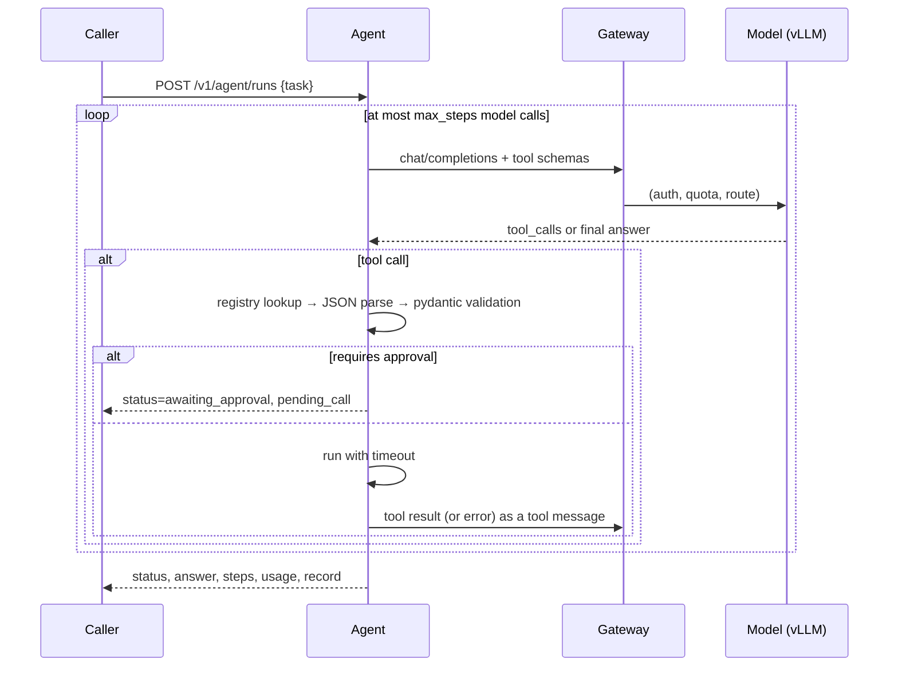

# Agent service

A tool-calling agent deployed as its own microservice. It has one dependency,
the gateway, and one credential, its gateway API key. It never talks to a model
server directly, so the gateway's auth, quotas and logging policy apply to it
like to any other tenant.

## Loop



The model proposes; code decides. Each step is checked in this order, and a
failure at any point becomes a tool message the model can react to, never an
exception that ends the run:

1. **Known tool?** Unknown names return the list of available tools.
2. **Parsable arguments?** Invalid JSON is reported with the parser's message.
3. **Valid arguments?** Each tool has a pydantic model (ranges, enums, lengths).
   `isa_atmosphere(altitude_m=99999)` is rejected with the field and the limit.
4. **Side effects?** Tools marked `requires_approval` are validated but not run.
   The run stops with `status: awaiting_approval` and the exact proposed call.
5. **Run with a timeout** in a worker thread, so a slow tool cannot block the loop.

The loop ends on a final answer, on an approval stop, or after `max_steps`
(default 6, capped at 10 per request), which bounds cost when a model keeps calling tools.

## Tools

| Tool | What it computes | Checked against |
|---|---|---|
| `isa_atmosphere` | T, p, ρ, speed of sound, 0–20 km | ICAO standard atmosphere tables at 0, 5, 11 and 15 km (`tests/test_tools.py`) |
| `convert_units` | length, pressure, force, mass, temperature | exact definitions (ft = 0.3048 m, lbf, psi); refuses cross-quantity conversions |
| `tolerance_stackup` | 1-D stack, worst case and RSS | hand-computed example |
| `submit_simulation_job` | (side effect) queue a CFD/FEA job | never executed by the agent; approval only |

Calculations are deterministic and done in code, not by the model. The
system prompt tells the model to use tools for every number; the tests check
that tool results, not model text, carry the values.

## Run record

Every response includes a `record`:

```json
{
  "run_id": "…", "request_id": "…", "started_at": "2026-…Z", "duration_ms": 41.3,
  "service_version": "0.1.0", "git_sha": "…", "prompt_version": "a1b2c3d4e5f6",
  "model": "chat", "tool_versions": {"isa_atmosphere": "1.0", "…": "…"}
}
```

together with every step (tool, arguments, outcome, result or error, duration)
and token usage. With the gateway's `x-gateway-upstream` header and log line
under the same request id, a run can be traced to the code version, the prompt
version, the concrete model that answered and each tool call it made.

## Mapping to the EU AI Act

This is not a compliance claim. Obligations depend on the system's risk class
and role, which a demo service does not have. The mechanisms are the ones those
obligations ask for:

| Obligation (Regulation (EU) 2024/1689) | Mechanism here |
|---|---|
| Record-keeping, automatic logging over the system's lifetime (Art. 12) | run record + per-step trace; gateway request log; both keyed by request id |
| Human oversight, ability to intervene before effects (Art. 14) | `requires_approval` tools stop the run and return the proposed call |
| Accuracy and robustness (Art. 15) | argument validation, bounded loop, tool timeouts, failover in the gateway |
| Technical documentation and traceability of versions (Art. 11, Annex IV) | git sha, prompt hash, tool versions, model alias + upstream in every record |

## What is not here

- Persisting run records (they are returned and logged; a store is deployment-specific).
- An approval endpoint that resumes a paused run. Today the caller re-submits after a human approves.
- Evaluation of a real model's tool-calling accuracy. The mock model is a test
  double: it proves the plumbing, not the model's judgement.
